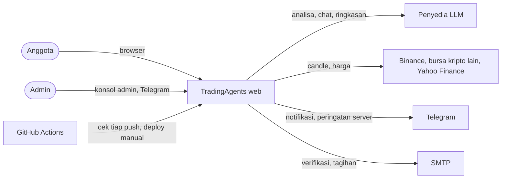
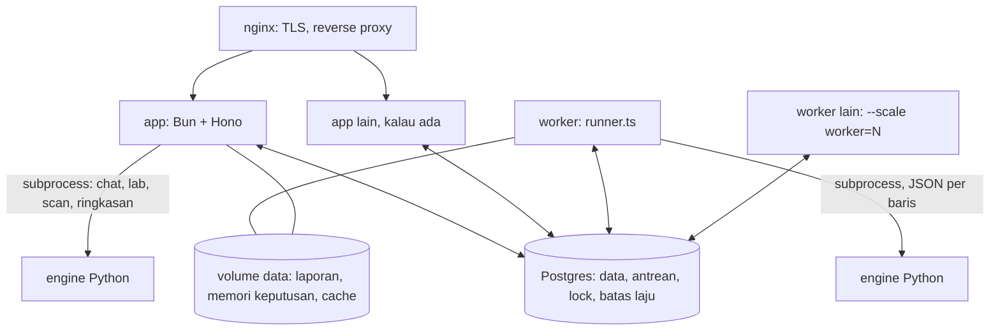

# Arsitektur

Aplikasi riset trading berbahasa Indonesia di atas engine TradingAgents (Python, multi-agen). Satu monolit modular (Bun + Hono) melayani API, halaman, dan kerja latar; proses worker terpisah menjalankan analisa; Postgres menyimpan data sekaligus mengoordinasikan semua proses. Keputusan di balik bentuk ini ada di [adr/](adr/).

## Konteks

## Container

| Container | Isi | Skala |
| --- | --- | --- |
| `app` | API, halaman publik dan `/app` (Svelte), scheduler (hanya di instance pemegang lock), chat agen, Lab | Beberapa instance di belakang nginx |
| `worker` | `src/runner.ts`: mengambil analisa dan backtest dari antrean dan menjalankan engine | `docker compose up -d --scale worker=N`, masing-masing `MAX_CONCURRENT_ANALYSES` sekaligus |
| `migrate` | `src/migrate.ts`, sekali jalan sebelum app dan worker diganti | Satu, saat deploy |
| `db` | Postgres 16 | Satu |

## Modul server (`web/server/src`)

| Area | Modul |
| --- | --- |
| HTTP | `app.ts` (route, middleware, error), `index.ts` (proses app), `runner.ts` (proses worker), `migrate.ts` |
| Akun dan sesi | `auth.ts`, `totp.ts`, `plans.ts`, `usage.ts`, `models.ts` |
| Analisa | `routes.ts` (rute), `jobs.ts` (antrean di Postgres), `worker.ts` (spawn engine), `tokens.ts` |
| Agen chart, Lab, skrip | `agent.ts`, `lab.ts`, `scripts.ts`, `script-run.ts` |
| Data pasar | `market.ts`, `binance.ts`, `venues.ts` |
| Notifikasi | `alerts.ts` (sinyal), `price-alerts.ts`, `watch.ts` (watchlist, Telegram), `ledger.ts` |
| Bisnis | `billing.ts`, `coupons.ts`, `invoice.ts`, `reminders.ts`, `business.ts`, `mail.ts` |
| Situs publik | `site.ts`, `status.ts`, `creators.ts` |
| Operasi | `locks.ts` (leader, lease), `limits.ts`, `shared.ts`, `errors.ts`, `log.ts`, `metrics.ts`, `monitor.ts`, `config.ts`, `openapi.ts` |

Kode bersama server dan klien ada di `web/shared` (paket dan batasnya, sandbox skrip QuickJS, brand). Mesin indikator ada dua kali: TypeScript untuk grafik (`web/client/src/lib/indicators`) dan Python untuk notifikasi (`web/worker`), dijaga tes paritas ([ADR 0003](adr/0003-indikator-dua-bahasa-tes-paritas.md)).

## Alur satu analisa

1. Klien memanggil `POST /api/analyses`. `requireAuth` memeriksa cookie sesi, `routes.ts` memvalidasi body dengan zod, mengganti provider dan model anggota dengan bawaan server, dan mengecek kuota.
2. Baris `analyses` ditulis berstatus `queued`; `enqueue()` mengirim `NOTIFY ta_jobs`.
3. Worker yang bebas mengambil baris tertua dengan `FOR UPDATE SKIP LOCKED` (status `running`, heartbeat), lalu menjalankan `python web/worker/ta_worker.py run`.
4. Setiap event engine disimpan di `analysis_events` dan diumumkan; baris `analyses` diperbarui (progres, laporan per bagian).
5. `GET /api/analyses/:id/events` (SSE) di instance app mana pun mendengar pengumuman itu, membaca event baru, dan mengirimnya ke browser; di akhir mengirim `end` dengan status dan rating.
6. Jalur gagal: worker tanpa event selama `JOB_IDLE_MINUTES` dibunuh; worker yang berhenti saat deploy menandai analisanya gagal dengan alasannya; heartbeat yang berhenti membuat baris ditandai gagal oleh instance pemegang scheduler; batal menandai baris lalu memberi tahu worker yang memegangnya.

## Kerja latar

Semua timer berjalan di setiap instance app, tetapi isinya hanya dikerjakan instance yang memegang advisory lock scheduler ([ADR 0005](adr/0005-satu-scheduler-advisory-lock.md)):
- pemindaian sinyal tiap slot 5 menit dan cek notifikasi harga tiap menit (`alerts.ts`, `price-alerts.ts`);
- watchlist harian, rekap sinyal harian dan mingguan, pengingat perpanjangan, ringkasan pasar AI;
- cek status tiap 5 menit (hasilnya di `shared_values`), peringatan server tiap menit (`monitor.ts`);
- pembersihan: error server lebih dari 30 hari, jendela batas laju yang sudah lewat, analisa yatim.

## Data

Postgres adalah sumber kebenaran dan alat koordinasi. Selain tabel produk (akun, pembayaran, analisa, notifikasi, ledger, Lab), ada tabel koordinasi: `leases` (kerja satu-satu: jawaban chat, uji Lab), `rate_limits`, `shared_values` (scan terakhir, cek status terakhir, status peringatan), dan antrean di `analyses` sendiri. Skema di `web/server/src/db/schema.ts`; migrasi di `web/server/drizzle/` dijalankan oleh service `migrate` ([ADR 0007](adr/0007-migrasi-langkah-deploy.md)). Backup harian, uji restore, dan salinan off-site: [runbooks/restore.md](runbooks/restore.md).

## Deploy

Satu image (`web/Dockerfile`) untuk app, worker, dan migrate. Rilis dikirim lewat GitHub Actions (Deploy, manual) ke `receive-release.sh` di VPS, yang menjalankan `deploy.sh` rilis itu: build, migrasi, ganti app dan worker, cek kesehatan, rollback otomatis kalau gagal ([ADR 0008](adr/0008-deploy-rilis-berdampingan.md), [runbooks/deploy.md](runbooks/deploy.md)).

## Celah yang diketahui

- Chat agen, uji Lab, pemindaian sinyal, dan ringkasan AI masih menjalankan engine di proses app.
- Belum ada staging; deploy langsung ke produksi setelah cek CI.
- CSP masih mode laporan; tracing belum dipasang.
- Kepemilikan data per user, belum per organisasi (Fase 3: organisasi, RBAC, SSO, audit log).
